# 你好，我是王秀睿 👋

  

点击上方工作台，打开我的个人网站

  🌐 <a href="https://xiaohaxi2-source.github.io/">个人网站</a> · 🧩 <a href="https://github.com/xiaohaxi2-source?tab=repositories">开源项目</a> · ✍️ <a href="./ARTICLES.md">全部文章</a> · 💬 <a href="https://xiaohaxi2-source.github.io/#contact">联系我</a>

---

## ⭐ 精选项目

  
  

  
  

  

哈的第二大脑 · AI 产品观察、工具与工作流

<strong>更多精选项目</strong>

- [个人网站](https://xiaohaxi2-source.github.io/)
- [浏览全部公开仓库](https://github.com/xiaohaxi2-source?tab=repositories)
- [项目与构想说明](./PROJECTS.md)

XR OS 已发布。知识空间、小小专注为概念展示；产品拆解笔记为研究示例，具体说明见对应页面。

## 📚 知识文档

  
  

<strong>更多知识文档</strong>

- [产品拆解清单](./resources/product-research.md)
- [用户访谈提纲](./resources/user-interview.md)
- [全部文章](./ARTICLES.md)

## 🧰 Skills

  
  

<strong>更多 Skills</strong>

- [AI 产品评估清单](./resources/ai-evaluation.md)
- [个人网站中的工具与资源](https://xiaohaxi2-source.github.io/#resources)

这里展示可阅读、可复用的方法模板。

---
